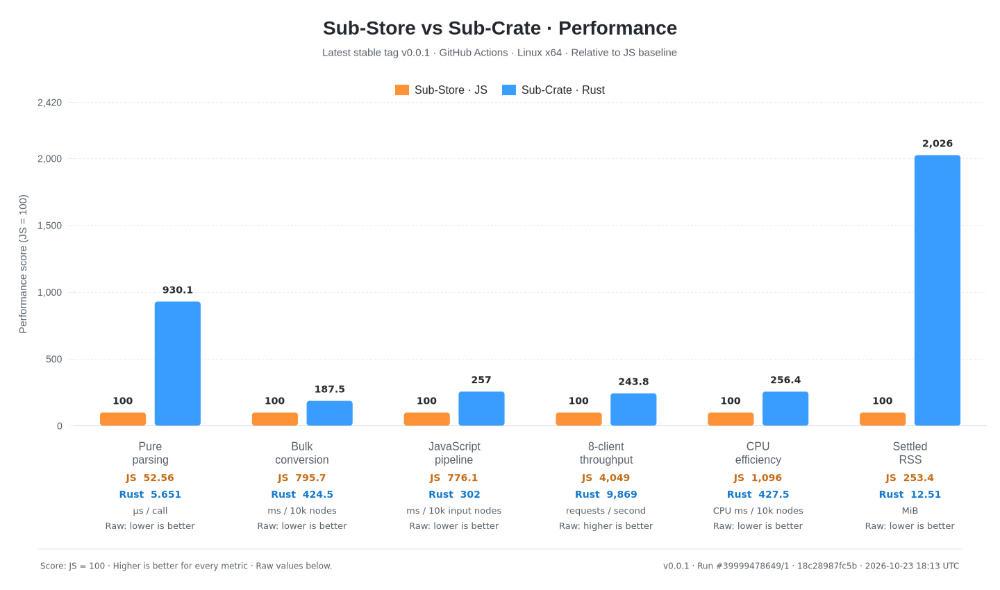

<!-- Logo -->

[](https://github.com/DSLZL/Sub-Crate/actions/workflows/rust-compat-native.yml)

Sub-Crate is a standalone Rust backend for [Sub-Store](https://github.com/sub-store-org/Sub-Store). Use the official [Sub-Store frontend](https://github.com/sub-store-org/Sub-Store-Front-End) without modification to manage subscriptions, convert proxy configurations and run general JavaScript.

[Get started](#get-started) · [Frontend](#frontend) · [Script compatibility](#script-compatibility) · [Documentation](#documentation)

## Get started

### Download a package

| Platform | Release archive |
| --- | --- |
| Linux x64 | `sub-crate-<version>-linux-x64.tar.gz` |
| Linux arm64 | `sub-crate-<version>-linux-arm64.tar.gz` |
| Windows x64 | `sub-crate-<version>-windows-x64.zip` |

See the [deployment guide](rust/README.md) for checksums, archive contents and runtime requirements.

### Start the backend

Linux:

```sh
mkdir -p data
SUB_STORE_DATA_BASE_PATH="$PWD/data" ./sub-crate
```

Windows PowerShell:

```powershell
New-Item -ItemType Directory -Force data | Out-Null
$env:SUB_STORE_DATA_BASE_PATH = (Join-Path $PWD data)
.\sub-crate.exe
```

The backend listens at `http://127.0.0.1:3000`, and `/api/utils/env` returns its protocol and Rust implementation metadata.

## Frontend

Use the official [hosted frontend](https://sub-store.vercel.app/subs), or download assets from the [frontend project](https://github.com/sub-store-org/Sub-Store-Front-End) and set `SUB_STORE_FRONTEND_PATH` to its `dist` directory. Backend releases do not build or bundle the frontend.

## Script compatibility

If a script has both JS and Node versions, use the general JS version.

Node builtins, CommonJS `require`, `process.env`, `$substore.node`, npm loading and native addons are not supported.

## Performance benchmarks



## Documentation

| Guide | Contents |
| --- | --- |
| [Deployment](rust/README.md) | Downloads, environment variables, frontend hosting, Docker, migration and rollback |
| [Acceptance contract](rust/ACCEPTANCE.md) | Fixed baselines, required platforms, tested scope and compatibility limits |
| [Compatibility tests](tests/compat/README.md) | Reference preparation, regression harnesses and retained evidence |
| [Performance records](tests/performance/README.md) | Benchmarks, measured source revisions and their limitations |
| [Cleanup inventory](rust/CLEANUP.md) | Removed upstream files and retained runtime, fixture and license dependencies |

Sub-Crate is based on the work of the [Sub-Store authors and contributors](https://github.com/sub-store-org/Sub-Store/graphs/contributors). It is licensed under [AGPL-3.0-only](LICENSE). Embedded utilities and delivered archives include their dependency license notices.

## Friendly Links

[LINUX DO](https://linux.do/)