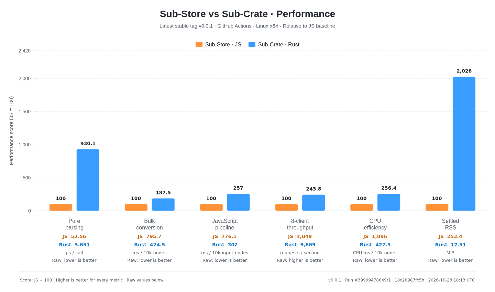

<!-- Logo -->

[](https://github.com/DSLZL/Sub-Crate/actions/workflows/rust-compat-native.yml)

Sub-Crate is a standalone Rust backend for [Sub-Store](https://github.com/sub-store-org/Sub-Store). It works with the official [Sub-Store frontend](https://github.com/sub-store-org/Sub-Store-Front-End) as is, keeps Sub-Store's data files and API, and runs without Node.js.

## Quick start

### Docker Compose

```sh
cp .env.example .env
docker compose -f docker-compose.example.yml up -d
```

### Native binary

Download the archive for your platform from [Releases](https://github.com/DSLZL/Sub-Crate/releases), extract it, then run:

```sh
./sub-crate          # Linux
.\sub-crate.exe      # Windows
```

The backend listens on port 3000 and stores data in the current directory. Open the [hosted frontend](https://sub-store.vercel.app/subs) and set the backend address to `http://127.0.0.1:3000`.

## Documentation

| Document | Read it to |
| --- | --- |
| [Deployment](docs/deployment.md) | Install, host the frontend, migrate from Sub-Store and roll back |
| [Configuration](docs/configuration.md) | Look up an environment variable |
| [Scripts](docs/scripts.md) | Check which JavaScript scripts run on Sub-Crate |
| [Development](docs/development.md) | Find your way around the code, CI and releases |
| [Acceptance](docs/ACCEPTANCE.md) | See what a release must pass |

## Benchmark



Higher is better; the Sub-Store Node.js baseline scores 100. See [performance tests](tests/performance/README.md) for the method.

## License

[AGPL-3.0-only](LICENSE). Sub-Crate builds on the work of the [Sub-Store contributors](https://github.com/sub-store-org/Sub-Store/graphs/contributors). Release archives include the license notices of embedded dependencies.

## Friendly links

[LINUX DO](https://linux.do/)
